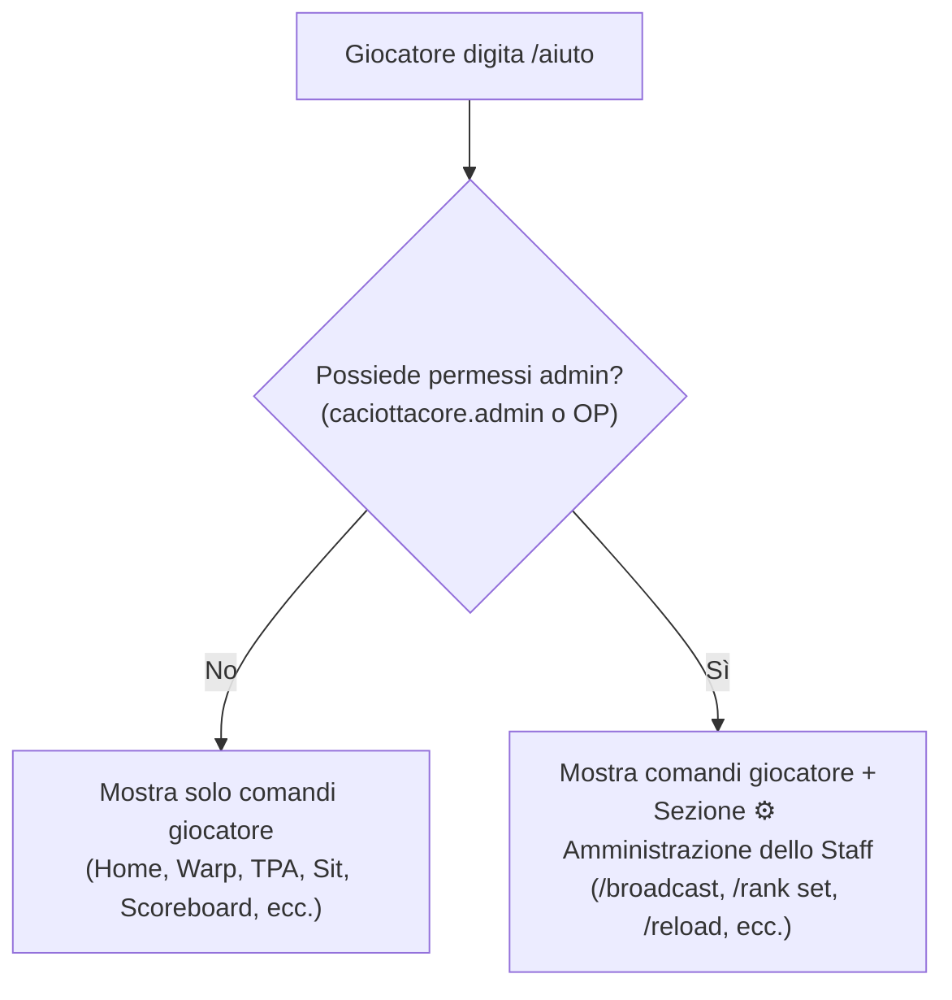
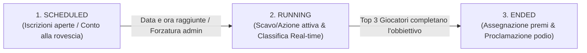

# 🧀 Direttive per lo Sviluppo di Nuovi Comandi - CaciottaCore

Questa guida contiene gli standard architetturali e le procedure obbligatorie per l'implementazione di nuovi comandi e moduli all'interno del plugin **CaciottaCore**.

Tutti i nuovi comandi sviluppati nel progetto devono rispettare i quattro pilastri fondamentali:
1. **Messaggi di default in italiano** (centralizzati e configurabili tramite `ConfigManager` e `config.yml`).
2. **Documentazione interattiva nel comando `/aiuto`** (con filtraggio visivo rigoroso tra comandi utente e admin).
3. **Pieno supporto al ciclo di ricarica a caldo** (integrazione nel comando `/reload` del plugin).
4. **Gestione centralizzata di date, orari e fuso orario** (utilizzo obbligatorio di `TimeManager` e `ConfigManager.getZoneId()` per sincronizzazione con il fuso italiano `Europe/Rome`).

---

## 📑 Indice
- [1. Standard Messaggi in Italiano](#1-standard-messaggi-in-italiano)
  - [1.1 Configurazione in config.yml](#11-configurazione-in-configyml)
  - [1.2 Mappa di Fallback in ConfigManager](#12-mappa-di-fallback-in-configmanager)
  - [1.3 Metodi di invio e formattazione](#13-metodi-di-invio-e-formattazione)
- [2. Documentazione nella Sezione /aiuto](#2-documentazione-nella-sezione-aiuto)
  - [2.1 Comandi Utente vs Comandi Admin](#21-comandi-utente-vs-comandi-admin)
  - [2.2 Come registrare un comando in HelpCommand](#22-come-registrare-un-comando-in-helpcommand)
  - [2.3 Comandi con Argomenti (Suggest) vs Comandi Immediati (Run)](#23-comandi-con-argomenti-suggest-vs-comandi-immediati-run)
- [3. Integrazione con il Sistema di Reload](#3-integrazione-con-il-sistema-di-reload)
  - [3.1 Implementazione del metodo reload() nel Manager](#31-implementazione-del-metodo-reload-nel-manager)
  - [3.2 Hook nel metodo reloadPlugin() di CaciottaCore](#32-hook-nel-metodo-reloadplugin-di-caciottacore)
  - [3.3 Notifica di feedback in ReloadCommand](#33-notifica-di-feedback-in-reloadcommand)
- [4. Gestione Centralizzata di Date, Orari e Fuso Orario](#4-gestione-centralizzata-di-date-orari-e-fuso-orario)
  - [4.1 Utilizzo di TimeManager](#41-utilizzo-di-timemanager)
  - [4.2 Reset Giornalieri e Formattazione con ConfigManager](#42-reset-giornalieri-e-formattazione-con-configmanager)
- [5. Workflow Completo: Checklist per un Nuovo Comando](#5-workflow-completo-checklist-per-un-nuovo-comando)
- [6. Direttive per lo Sviluppo di Nuovi Eventi a Premi](#6-direttive-per-lo-sviluppo-di-nuovi-eventi-a-premi)
  - [6.1 I 5 Requisiti Obbligatori di ogni Evento](#61-i-5-requisiti-obbligatori-di-ogni-evento)
  - [6.2 Architettura del Ciclo di Vita (State Machine)](#62-architettura-del-ciclo-di-vita-state-machine)
  - [6.3 Come Aggiungere un Nuovo Tipo di Evento (EventType)](#63-come-aggiungere-un-nuovo-tipo-di-evento-eventtype)
  - [6.4 Configurazione YAML in events.yml](#64-configurazione-yaml-in-eventsyml)
  - [6.5 Supporto alla Doppia Scoreboard Dinamica](#65-supporto-alla-doppia-scoreboard-dinamica)
  - [6.6 Comandi Amministrativi di Gestione](#66-comandi-amministrativi-di-gestione)
  - [6.7 Direttive per il Reset dell'Evento e Cancellazione Classifica](#67-direttive-per-il-reset-dellevento-e-cancellazione-classifica)
  - [6.8 Direttive per l'Assegnazione dei Premi (Scelta Utente e Intervento Admin)](#68-direttive-per-lassegnazione-dei-premi-scelta-utente-e-intervento-admin)
  - [6.9 Direttive per la Ricarica a Caldo di events.yml (Data e Parametri)](#69-direttive-per-la-ricarica-a-caldo-di-eventsyml-data-e-parametri)
  - [6.10 Checklist per il Rilascio di un Nuovo Evento](#610-checklist-per-il-rilascio-di-un-nuovo-evento)

---

## 1. Standard Messaggi in Italiano

Tutti i messaggi rivolti ai giocatori e alla console (errori di sintassi, permessi negati, avvisi di successo, timer, ecc.) **devono essere scritti in italiano corretto** con codici colore Minecraft standard (`&a`, `&c`, `&e`, `&7`, ecc.).

> [!IMPORTANT]
> **Nessun messaggio deve essere hardcoded** all'interno della classe del comando. Ogni stringa mostrata all'utente deve passare attraverso [ConfigManager](file:///c:/Users/gian/Documents/CaciottaCore/src/main/java/it/caciotta/core/config/ConfigManager.java).

### 1.1 Configurazione in `config.yml`
Aggiungi le chiavi di testo sotto la sezione `messages.<modulo>` in [src/main/resources/config.yml](file:///c:/Users/gian/Documents/CaciottaCore/src/main/resources/config.yml):

```yaml
messages:
  # Esempio per nuovo modulo "teleport"
  teleport:
    usage: "&cUso corretto: &e/{label} <destinazione>"
    not-found: "&cLa destinazione &e{target} &cnon e stata trovata."
    success: "&aTeletrasportato con successo a &e{target}&a!"
    cooldown: "&7Attendi &e{seconds} secondi &7prima di riutilizzare il comando."
```

### 1.2 Mappa di Fallback e Auto-Aggiornamento in `ConfigManager`
Per garantire la massima resilienza:
1. **Fallback in memoria**: definisci sempre i valori di default nella mappa `DEFAULT_MESSAGES` di [ConfigManager.java](file:///c:/Users/gian/Documents/CaciottaCore/src/main/java/it/caciotta/core/config/ConfigManager.java) per evitare stringhe vuote.
2. **Auto-Aggiornamento del `config.yml` su disco**: [ConfigManager.java](file:///c:/Users/gian/Documents/CaciottaCore/src/main/java/it/caciotta/core/config/ConfigManager.java) include il metodo `updateConfigOnDisk()`. Ad ogni avvio o reload, il plugin confronta il file generato sul server con il file di default del JAR ed **aggiunge automaticamente qualsiasi nuova sezione, parametro o messaggio mancante**, preservando sia i valori personalizzati già modificati dall'utente sia i commenti di spiegazione.

```java
// In ConfigManager.java -> DEFAULT_MESSAGES
Map.entry("teleport.usage", "&cUso corretto: &e/{label} <destinazione>"),
Map.entry("teleport.not-found", "&cLa destinazione &e{target} &cnon e stata trovata."),
Map.entry("teleport.success", "&aTeletrasportato con successo a &e{target}&a!"),
Map.entry("teleport.cooldown", "&7Attendi &e{seconds} secondi &7prima di riutilizzare il comando.")
```

### 1.3 Metodi di invio e formattazione
Nel tuo comando, utilizza i metodi helper per recuperare il testo con prefisso e sostituire i placeholder:

```java
// Messaggio semplice con prefisso del plugin
MessageUtil.sendMessage(sender, configManager.getPrefixedMessage("teleport.usage", Map.of("label", label)));

// Messaggio con placeholder dinamici
MessageUtil.sendMessage(player, configManager.getPrefixedMessage("teleport.success", Map.of("target", targetName)));
```

---

## 2. Documentazione nella Sezione `/aiuto`

Tutti i comandi devono essere registrati nel comando interattivo `/aiuto` gestito da [HelpCommand.java](file:///c:/Users/gian/Documents/CaciottaCore/src/main/java/it/caciotta/core/help/HelpCommand.java).



### 2.1 Comandi Utente vs Comandi Admin
- **Comandi Utente**: visibili a chiunque esegua `/aiuto`. Vengono creati tramite il metodo:
  ```java
  createCmd(String usage, String description, String clickCmd, boolean suggestOnly)
  ```
- **Comandi Admin**: visibili **esclusivamente** a chi possiede il permesso `caciottacore.admin` o è operatore `OP`. Vengono creati tramite il metodo:
  ```java
  createAdminCmd(String usage, String description, String clickCmd, boolean suggestOnly)
  ```

### 2.2 Come registrare un comando in `HelpCommand`

All'interno di [HelpCommand.java](file:///c:/Users/gian/Documents/CaciottaCore/src/main/java/it/caciotta/core/help/HelpCommand.java):

#### A. Nella schermata riassuntiva principale (`showAllHelp`):
1. **Se il comando è per tutti gli utenti**:
   ```java
   sender.sendMessage(createCmd("/miocomando", "Descrizione concisa dell'azione", "/miocomando", false));
   ```
2. **Se il comando è per lo staff**:
   Inserirlo rigorosamente all'interno del blocco `if (isAdmin)`:
   ```java
   if (isAdmin) {
       sender.sendMessage(createAdminCmd("/miocomando admin <azione>", "Descrizione azione staff", "/miocomando admin ", true));
   }
   ```

#### B. Nelle sezioni specifiche per categoria (`showSection`):
Ogni modulo deve avere una sezione dedicata o essere accorpato a una esistente (es. `home`, `warp`, `tpa`, `rank`, `admin`):

```java
case "teleport" -> {
    sender.sendMessage(MessageUtil.format("&6🌀 Dettagli Comandi Teletrasporto:"));
    sender.sendMessage(createCmd("/teleport <luogo>", "Teletrasportati in un luogo pubblico", "/teleport ", true));
    
    // Filtro admin all'interno della sottosezione
    if (isAdmin) {
        sender.sendMessage(createAdminCmd("/teleport set <luogo>", "Crea un nuovo punto pubblico", "/teleport set ", true));
    }
}
```

### 2.3 Comandi con Argomenti (`Suggest`) vs Comandi Immediati (`Run`)
Il quarto parametro booleano `suggestOnly` determina cosa succede quando il giocatore clicca sul comando in chat:
- **`true` (Suggest)**: Da usare quando il comando **richiede argomenti obbligatori** (es. `/sethome <nome>`, `/warp <destinazione>`, `/broadcast <msg>`). Il comando viene copiato nella chat del giocatore pronto per completare i parametri.
- **`false` (Run)**: Da usare quando il comando è **auto-conclusivo senza argomenti obbligatori** (es. `/homes`, `/sit`, `/reload`, `/sb`). Cliccandolo viene eseguito immediatamente.

---

## 3. Integrazione con il Sistema di Reload

CaciottaCore supporta la ricarica completa a caldo tramite [`/reload`](file:///c:/Users/gian/Documents/CaciottaCore/src/main/java/it/caciotta/core/command/ReloadCommand.java). Se un nuovo comando fa uso di configurazioni, file YAML o cache in memoria, **deve poter essere ricaricato senza riavviare il server**.

### 3.1 Implementazione del metodo `reload()` nel Manager
Il gestore del nuovo modulo (es. `TeleportManager`) deve esporre un metodo `reload()`:

```java
package it.caciotta.core.teleport;

public class TeleportManager {

    private final CaciottaCore plugin;
    private final File dataFile;
    private final Map<String, Location> cache = new ConcurrentHashMap<>();

    public synchronized void reload() {
        // 1. Svuota le cache in memoria
        cache.clear();

        // 2. Ricarica i file di configurazione da disco
        loadDataFromDisk();

        plugin.getLogger().info("TeleportManager ricaricato con successo.");
    }
    
    // ...
}
```

### 3.2 Hook nel metodo `reloadPlugin()` di `CaciottaCore`
Aggancia la chiamata al metodo `reload()` in [CaciottaCore.java](file:///c:/Users/gian/Documents/CaciottaCore/src/main/java/it/caciotta/core/CaciottaCore.java#L205):

```java
// In CaciottaCore.java -> reloadPlugin()
public void reloadPlugin() {
    if (configManager != null) {
        configManager.reload();
    }
    if (rankManager != null) {
        rankManager.reload();
    }
    // ... altri manager ...

    // Integrazione del nuovo modulo:
    if (teleportManager != null) {
        teleportManager.reload();
    }

    getLogger().info("Tutte le configurazioni e i moduli di CaciottaCore sono stati ricaricati con successo.");
}
```

### 3.3 Notifica di feedback in `ReloadCommand`
Aggiungi una voce descrittiva all'elenco dei moduli ricaricati mostrato all'admin in [ReloadCommand.java](file:///c:/Users/gian/Documents/CaciottaCore/src/main/java/it/caciotta/core/command/ReloadCommand.java):

```java
MessageUtil.sendMessage(sender, " &8» &eteleport &7(Destinazioni e cache posizioni)");
```

---

## 4. Gestione Centralizzata di Date, Orari e Fuso Orario

Qualora un nuovo comando o modulo debba interagire con **data e ora correnti, scadenze, timer, formattazione timestamp o reset giornalieri** (es. contatori giornalieri di `/tpback`), **è obbligatorio fare affidamento al sistema centralizzato** del plugin basato su fuso orario italiano (`Europe/Rome`).

> [!WARNING]
> **Non utilizzare mai** chiamate native prive di fuso orario come `LocalDate.now()` o `LocalTime.now()`, né istanziare `SimpleDateFormat` senza configurare il `TimeZone`. Poiché i server possono risiedere su VPS o host con orario UTC o fusi orari esteri, l'assenza del fuso comporta desincronizzazioni con i giocatori italiani e reset giornalieri ad orari errati.

### 4.1 Utilizzo di `TimeManager`
Il plugin fornisce il gestore [TimeManager.java](file:///c:/Users/gian/Documents/CaciottaCore/src/main/java/it/caciotta/core/time/TimeManager.java), accessibile tramite `plugin.getTimeManager()`, già configurato con il fuso orario del server:

```java
TimeManager timeManager = plugin.getTimeManager();

// Ottenere data e ora correnti nel fuso italiano
ZonedDateTime now = timeManager.now();
LocalDate today = timeManager.today();
LocalTime time = timeManager.currentTime();

// Stringhe formattate pronte per i messaggi o la scoreboard
String dataStr = timeManager.getFormattedDate();       // Es: "13/10/2026"
String oraStr = timeManager.getFormattedTime();         // Es: "20:55:00"
String oraBreve = timeManager.getFormattedShortTime();  // Es: "20:55"
String giorno = timeManager.getDayOfWeek();             // Es: "Martedì"

// Formattare un timestamp epoch (millisecondi) in formato leggibile
String dataFormattata = timeManager.formatTimestamp(System.currentTimeMillis());
```

### 4.2 Reset Giornalieri e Formattazione con `ConfigManager`
Se il modulo gestisce logiche a basso livello (come reset a mezzanotte o persistenza YAML), ricava sempre il `ZoneId` configurato tramite `configManager.getZoneId()`:

```java
// Reset giornaliero (es. TpBackManager):
String oggi = LocalDate.now(configManager.getZoneId()).toString();

// Formattazione thread-safe di scadenze sanzioni (es. ModerationManager):
String scadenza = Instant.ofEpochMilli(punishment.getExpiresAt())
        .atZone(configManager.getZoneId())
        .format(DateTimeFormatter.ofPattern("dd/MM/yyyy HH:mm"));
```

---

## 5. Workflow Completo: Checklist per un Nuovo Comando

Quando aggiungi un nuovo comando a CaciottaCore, segui rigorosamente questa sequenza:

| Fase | File da Modificare | Azione Richiesta |
|---|---|---|
| **1. Logica** | `src/main/java/it/caciotta/core/<modulo>/MioCommand.java` | Crea la classe che implementa `CommandExecutor` e `TabCompleter`. Se gestisci orari o date, usa sempre `TimeManager` o `configManager.getZoneId()`. |
| **2. Testi IT** | [config.yml](file:///c:/Users/gian/Documents/CaciottaCore/src/main/resources/config.yml) | Aggiungi tutte le chiavi dei messaggi in italiano sotto `messages.<modulo>`. |
| **3. Fallback IT** | [ConfigManager.java](file:///c:/Users/gian/Documents/CaciottaCore/src/main/java/it/caciotta/core/config/ConfigManager.java) | Aggiungi i messaggi di fallback nella mappa `DEFAULT_MESSAGES`. |
| **4. Manifest** | [plugin.yml](file:///c:/Users/gian/Documents/CaciottaCore/src/main/resources/plugin.yml) | Registra il comando (`description`, `usage`, `aliases`, `permission`) e dichiara i relativi nodi di permesso con i permessi figli. |
| **5. Registrazione** | [CaciottaCore.java](file:///c:/Users/gian/Documents/CaciottaCore/src/main/java/it/caciotta/core/CaciottaCore.java) | Inizializza il comando in `onEnable()`, collegando executor e tab-completer. |
| **6. Reload** | `MioManager.java` e [CaciottaCore.java](file:///c:/Users/gian/Documents/CaciottaCore/src/main/java/it/caciotta/core/CaciottaCore.java) | Crea `public void reload()` nel Manager e invocalo in `CaciottaCore.reloadPlugin()`. |
| **7. Guida /aiuto** | [HelpCommand.java](file:///c:/Users/gian/Documents/CaciottaCore/src/main/java/it/caciotta/core/help/HelpCommand.java) | Documenta il comando nel menù generale e nella sezione apposita con filtro `if (isAdmin)` per i comandi riservati. |
| **8. Readme** | [README.md](file:///c:/Users/gian/Documents/CaciottaCore/README.md) | Aggiorna la tabella comandi, permessi e descrizioni nella documentazione ufficiale. |
| **9. Compilazione** | Shell Maven | Esegui `.\mvnw.cmd clean package` per verificare che non ci siano errori e aggiornare il JAR in `target/`. |

---

## 6. Direttive per lo Sviluppo di Nuovi Eventi a Premi

Il modulo **Eventi a Premi** (`it.caciotta.core.event`) permette di organizzare competizioni a tempo per la community con ricompense speciali e monitoraggio in tempo reale.

Tutti i nuovi eventi creati all'interno di CaciottaCore devono conformarsi agli standard architetturali definiti in questa sezione.



---

### 6.1 I 5 Requisiti Obbligatori di ogni Evento

Ogni evento a premi sviluppato o configurato nel plugin **deve obbligatoriamente implementare i seguenti 5 pilastri**:

1. **Data e ora di inizio**: definita nel formato `dd/MM/yyyy HH:mm` ed elaborata esclusivamente tramite `TimeManager` con il fuso orario configurato (`Europe/Rome`). L'avvio dell'evento scatta in automatico al raggiungimento della data impostata, oppure su comando staff `/evento admin start`.
2. **Obbiettivo numerico da raggiungere**: una quantità target esatta (es. 10.000 blocchi scavati, 500 mob uccisi, ecc.) configurata in `events.yml`.
3. **Classifica in tempo reale**: un sistema dinamico che traccia l'avanzamento dei partecipanti e permette di visualizzare in qualsiasi momento la top 10 con `/evento top` o `/evento classifica`.
4. **Termine al completamento della Top 3 e Premi a Scelta tramite Staff**: l'evento non si conclude a tempo indefinito, bensì **non appena i primi 3 giocatori classificati raggiungono l'obbiettivo target**. **I premi NON devono essere attribuiti in base alla posizione (1°, 2° o 3° posto) e NON devono essere assegnati automaticamente dal plugin**. I 3 vincitori hanno il diritto di scegliere uno tra i premi in palio comunicando la propria preferenza allo staff, dopodiché un amministratore procederà all'assegnazione manuale tramite il comando staff `/evento admin giveprize <giocatore> <premio>`. L'evento viene automaticamente dichiarato concluso al completamento della Top 3 con annuncio globale ed effetti sonori.
5. **Obbligo di conferma partecipazione**: la sola presenza sul server non registra i progressi. Ogni giocatore **deve confermare espressamente la propria partecipazione** digitando `/evento partecipa` (o cliccando sul pulsante interattivo in chat `[CONFERMA PARTECIPAZIONE]`). Se un utente non è confermato, le sue azioni non vengono conteggiate né salvate nella classifica.

---

### 6.2 Architettura del Ciclo di Vita (State Machine)

Lo stato di ogni evento è regolato dall'enum `EventState`:

| Stato | Descrizione | Azioni consentite |
|---|---|---|
| `SCHEDULED` | L'evento è pianificato per una data futura. | Iscrizioni e conferme aperte (`/evento partecipa`), visualizzazione dettagli e conto alla rovescia. |
| `RUNNING` | L'evento è in corso. | Conteggio azioni in tempo reale per i partecipanti confermati, aggiornamento classifica, podio e scoreboard attiva. |
| `ENDED` | I primi 3 classificati hanno raggiunto il target (o l'evento è stato interrotto). | I punteggi sono congelati, i premi assegnati e la classifica finale resta consultabile. |

---

### 6.3 Come Aggiungere un Nuovo Tipo di Evento (`EventType`)

Se l'evento richiede un'azione diversa dallo scavo di blocchi (`BLOCK_BREAK` dell'evento Scavatore):

#### 1. Registrare il tipo in `EventType.java`:
```java
public enum EventType {
    BLOCK_BREAK("Scavo Blocchi"),
    MOB_KILL("Uccisione Mostri"),
    FISH_CATCH("Pesca Tesori"),
    BLOCK_PLACE("Costruzione Blocchi"),
    PLAYER_KILL("Uccisioni PvP");
    // Aggiungi qui il nuovo tipo...
}
```

#### 2. Agganciare l'evento Bukkit in `EventListener.java`:
Intercetta l'evento di gioco pertinente verificando che:
1. Il giocatore sia in modalità Survival o Adventure (`player.getGameMode() == GameMode.SURVIVAL`).
2. L'evento corrente sia attivo e corrisponda al tipo richiesto.
3. Invoca `eventManager.recordProgress(player, quantità)`:

```java
@EventHandler(priority = EventPriority.MONITOR, ignoreCancelled = true)
public void onEntityDeath(EntityDeathEvent event) {
    if (!(event.getEntity().getKiller() instanceof Player player)) return;
    if (player.getGameMode() != GameMode.SURVIVAL) return;

    GameEvent current = eventManager.getCurrentEvent();
    if (current == null || !current.isRunning() || current.getType() != EventType.MOB_KILL) {
        return;
    }

    // La verifica della conferma di partecipazione e il raggiungimento dell'obbiettivo
    // avvengono in modo centralizzato e thread-safe all'interno di recordProgress:
    eventManager.recordProgress(player, 1);
}
```

---

### 6.4 Configurazione YAML in `events.yml`

Tutti gli eventi sono definiti in [src/main/resources/events.yml](file:///c:/Users/gian/Documents/CaciottaCore/src/main/resources/events.yml):

```yaml
# ID dell'evento attivo nel ciclo attuale
active-event: "cacciatore"

events:
  cacciatore:
    name: "&6&lEvento Cacciatore di Mostri"
    description: "Elimina 500 mostri ostili per conquistare il podio!"
    type: "MOB_KILL"
    target: 500
    start-date: "01/11/2026 18:00" # dd/MM/yyyy HH:mm fuso Europe/Rome
    prizes:
      rank:
        type: "RANK"
        rank: "scavatore"
        description: "&6Rank Scavatore &7con vantaggi esclusivi"
      netherite:
        type: "NETHERITE_FULLSET"
        description: "&5Fullset Netherite &7con enchant leggendari a sorpresa"
      dungeon:
        type: "DUNGEON_TELEPORT"
        description: "&dTeletrasporto &7a dungeon/strutture inesplorate"
```

---

### 6.5 Supporto alla Doppia Scoreboard Dinamica

Il sistema integra due scoreboard distinte gestite in sinergia da `ScoreboardManager`:

1. **Scoreboard Ordinaria (`scoreboard.lines`)**:
   Mostrata quotidianamente ai giocatori. Può contenere i placeholder informativi sull'evento programmato:
   - `{event_name}`: Nome dell'evento (es. `Evento Scavatore`).
   - `{event_status}`: Stato formattato (`In attesa`, `In corso`, `Terminato`).
   - `{event_start}`: Data e ora di avvio programmata.
   - `{event_target}`: Quantità di blocchi/azioni da raggiungere (`10.000`).
   - `{event_participants}`: Conteggio partecipanti confermati.
   - `{event_timer}`: Conto alla rovescia automatico all'avvio o alla chiusura (es. `01g 04h 30m`, `02:15:30` o `In corso`).

2. **Seconda Scoreboard Dinamica Evento (`scoreboard.event-scoreboard`)**:
   Non appena l'evento passa allo stato `RUNNING`, se abilitata in `config.yml`, la sidebar **si trasforma automaticamente nella Scoreboard dell'Evento**:
   - Titolo dinamico dedicato (`scoreboard.event-scoreboard.title`).
   - `{event_blocks_broken}` / `{event_placeholders_blocks}`: Blocchi totali distrutti da tutti i partecipanti.
   - `{event_player_score}` / `{event_blocks}`: Punteggio personale (blocchi scavati dal giocatore).
   - `{event_player_progress}`: Progresso personale formato `score/target` o numerico.
   - `{event_player_rank}`: Posizione personale in classifica (es. `1°`, `2°`, `3°`, `4°`, o `N/D`).
   - `{event_player_remaining}`: Blocchi mancanti al traguardo personale.
   - `{event_player_percent}`: Percentuale personale di completamento (es. `45.2%`).
   - `{event_player_confirmed}`: Stato conferma personale (`&aConfermato` o `&cNon Iscritto`).
   - Podio Top 3 in tempo reale:
     - Nomi: `{event_top_1_name}`, `{event_top_2_name}`, `{event_top_3_name}`.
     - Punteggi: `{event_top_1_score}`, `{event_top_2_score}`, `{event_top_3_score}`.
     - Voci complete formattate: `{event_top_1}`, `{event_top_2}`, `{event_top_3}` (es. `1° Steve - 5.420 blocchi`).
   - Opzione `only-participants`: se impostata su `true`, mostra la seconda scoreboard solo a chi ha confermato la partecipazione; se `false`, la mostra a tutti per incentivare la competizione.

---

### 6.6 Comandi Amministrativi di Gestione

Lo staff (permesso `caciottacore.admin` o `caciottacore.event.admin`) ha a disposizione una suite completa di comandi:

- `/evento admin start [id]`: forza l'avvio immediato dell'evento specificato o corrente, bypassando l'attesa della data.
- `/evento admin stop`: interrompe forzatamente l'evento in corso, congelando la classifica.
- `/evento admin kick <giocatore>`: **espelle un partecipante sia prima che durante l'evento**, resettando i suoi progressi e rimuovendolo dalla lista degli iscritti.
- `/evento admin setprogress <giocatore> <valore>`: imposta manualmente il punteggio o i blocchi scavati da un giocatore per correggere anomalie o premiare azioni speciali.
- `/evento admin reset`: azzera partecipanti, vincitori e punteggi dell'evento corrente, ripristinandolo allo stato iniziale `SCHEDULED`.
- `/evento admin reload`: ricarica istantaneamente il file `events.yml` senza riavviare il server.
- `/evento admin giveprize <giocatore> <premio>`: **assegna manualmente il premio scelto dall'utente ad un vincitore** (`rank`, `netherite`, `dungeon`), rispettando la preferenza espressa dal giocatore allo staff.

---

### 6.7 Direttive per il Reset dell'Evento e Cancellazione Classifica

Quando un evento viene azzerato tramite il comando amministrativo `/evento admin reset`, o viene ripristinato prima di una nuova edizione, **è obbligatorio seguire questa procedura di pulizia integrale**:

1. **Azzeramento istantaneo in memoria**:
   - Pulizia di tutti i punteggi e blocchi accumulati dai giocatori (`scores.clear()`).
   - Rimozione completa di tutti i vincitori proclamati e dei relativi timestamp di vittoria (`winners.clear()`, `winnerTimes.clear()`).
   - Revoca di tutte le iscrizioni dei partecipanti (`participants.clear()`, `participantNames.clear()`), imponendo una nuova conferma di partecipazione per il ciclo successivo.
   - Ripristino dello stato dell'evento a `SCHEDULED` (in attesa di nuovo avvio).

2. **Pulizia profonda del file YAML di persistenza (`data/events_data.yml`)**:
   - Prima di richiamare `saveData()`, le sezioni relative ai punteggi (`scores`), partecipanti (`participants`), nomi (`participantNames`), vincitori (`winners`) e premi assegnati (`assigned_prizes`) devono essere esplicitamente impostate a `null`. In questo modo si garantisce che nessuna vecchia riga persista su disco generando dati orfani o classifiche fantasma.

3. **Notifica globale di reset**:
   - Il reset deve emettere un annuncio globale in chat per informare tutti i giocatori connessi dell'azzeramento della competizione e della classifica.

4. **Sincronizzazione immediata della Scoreboard**:
   - È obbligatorio invocare immediatamente `ScoreboardManager.updateAll()` affinché le scoreboard di tutti i giocatori online riflettano all'istante l'azzeramento dei punteggi e il reset del podio.

---

### 6.8 Direttive per l'Assegnazione dei Premi (Scelta Utente e Intervento Admin)

Per garantire la massima soddisfazione e flessibilità ai giocatori, l'assegnazione dei premi segue queste regole fondamentali:

1. **Nessun vincolo alla posizione del podio**:
   - I premi **non devono mai essere rigidamente predefiniti in base alla posizione di arrivo (1°, 2° o 3° posto)**. I primi 3 partecipanti che raggiungono il target acquisiscono paritariamente il diritto di salire sul podio e di scegliere il premio desiderato tra quelli disponibili nell'evento (es. Rank Scavatore, Fullset Netherite leggendario o Teletrasporto a dungeon/strutture inesplorate).

2. **Nessuna assegnazione automatica**:
   - Al raggiungimento dell'obbiettivo, il plugin **non assegna automaticamente item o rank** all'utente. Il sistema si limita a registrare il giocatore tra i vincitori della Top 3, ad inviare il broadcast di vittoria e ad avvisare il vincitore (tramite Title e messaggio in chat) di comunicare la propria scelta allo staff.

3. **Attribuzione manuale tramite Staff**:
   - Lo staff raccoglie la decisione del vincitore e utilizza il comando amministrativo `/evento admin giveprize <giocatore> <premio>` (con tab-completion automatica per i nomi dei vincitori e per i premi `rank`, `netherite`, `dungeon`).
   - Il comando esegue in sicurezza l'assegnazione:
     - `rank`: imposta il grado tramite `RankManager` (funzionante anche se l'utente è offline).
     - `netherite`: genera il fullset con enchant speciali e lo inserisce nell'inventario del giocatore online (o lo rilascia a terra se l'inventario è pieno).
     - `dungeon`: abilita il giocatore al teletrasporto verso strutture non esplorate e gli consegna la pergamena dedicata.

4. **Tracciamento e persistenza dei premi**:
   - I premi attribuiti dallo staff vengono salvati in `data/events_data.yml` sotto la sezione `assigned_prizes.<uuid>` per prevenire doppie attribuzioni accidentali e consentire controlli amministrativi storici.

---

### 6.9 Direttive per la Ricarica a Caldo di events.yml (Data e Parametri)

Qualsiasi modifica apportata manualmente al file di configurazione `events.yml` (es. cambio data di inizio, modifica dell'obbiettivo `target`, variazione del nome dell'evento o passaggio ad un altro `active-event`) deve essere recepita immediatamente ed a caldo tramite il comando `/reload` (o `/evento admin reload`):

1. **Aggiornamento in-place dei parametri dell'evento attivo**:
   - Quando `loadConfig()` rileva che l'evento attivo in memoria corrisponde a quello configurato, **è obbligatorio aggiornare tutti i campi dell'oggetto in memoria** (`startDate`, `startDateRaw`, `target`, `displayName`, `description`, `type`), senza limitarsi a saltare il caricamento.
   - In caso contrario, l'istanza dell'evento manterrebbe in memoria i vecchi valori di avvio e i vecchi obbiettivi fino al riavvio completo del server (violazione del *Pilastro 3: Ricarica a caldo*).

2. **Riprogrammazione e ripristino dello stato `SCHEDULED`**:
   - Se un amministratore modifica la data di inizio impostandone una futura (successiva ad adesso rispetto al fuso `Europe/Rome`), l'evento deve tornare automaticamente nello stato `SCHEDULED`, sia che si trovasse precedentemente in `ENDED` (evento concluso in un'edizione passata) sia in `RUNNING`.
   - In questo modo lo scheduler periodico ricomincia a tracciare il conto alla rovescia e pianifica il lancio automatico per il nuovo orario indicato.

3. **Flessibilità nei formati di data e ora**:
   - Il parser deve supportare nativamente il formato standard `dd/MM/yyyy HH:mm` (es. `25/10/2026 21:00`) affiancato da formati con secondi (`dd/MM/yyyy HH:mm:ss`) o standard ISO (`yyyy-MM-dd HH:mm`), evitando che piccoli errori di digitazione blocchino il modulo o facciano fallire il parsing.

4. **Sincronizzazione forzata delle Scoreboard**:
   - Alla conclusione del metodo `reload()`, `EventManager` deve invocare esplicitamente `ScoreboardManager.updateAll()`. In questo modo le scoreboard di tutti i giocatori online aggiornano all'istante i placeholder `{event_start}` e `{event_timer}` con la nuova data e il nuovo countdown senza dover attendere il tick successivo.

---

### 6.10 Checklist per il Rilascio di un Nuovo Evento

Prima di rilasciare un nuovo evento nel server, verifica la seguente checklist:

- [ ] **Tipo azione**: se non è `BLOCK_BREAK`, hai aggiunto il valore in `EventType` e agganciato il relativo listener?
- [ ] **Data di inizio**: hai impostato una data valida nel formato `dd/MM/yyyy HH:mm` sincronizzata con il fuso italiano `Europe/Rome`?
- [ ] **Ricarica a caldo**: se modifichi la data in `events.yml` ed esegui `/reload`, la scoreboard mostra istantaneamente la nuova data?
- [ ] **Obbiettivo numerico**: il valore `target` in `events.yml` è proporzionato e stimolante per i giocatori?
- [ ] **Premi a scelta**: i premi in palio non sono assegnati automaticamente e possono essere scelti dai vincitori con `/evento admin giveprize`?
- [ ] **Conferma partecipazione**: il comando `/evento partecipa` è testato e visibile nei broadcast e in `/aiuto eventi`?
- [ ] **Scoreboard in tempo reale**: la scoreboard evento mostra correttamente i blocchi distrutti e la classifica aggiornata?
- [ ] **Compilazione**: `.\mvnw.cmd clean package` compila con `BUILD SUCCESS` e tutti i test superati.


