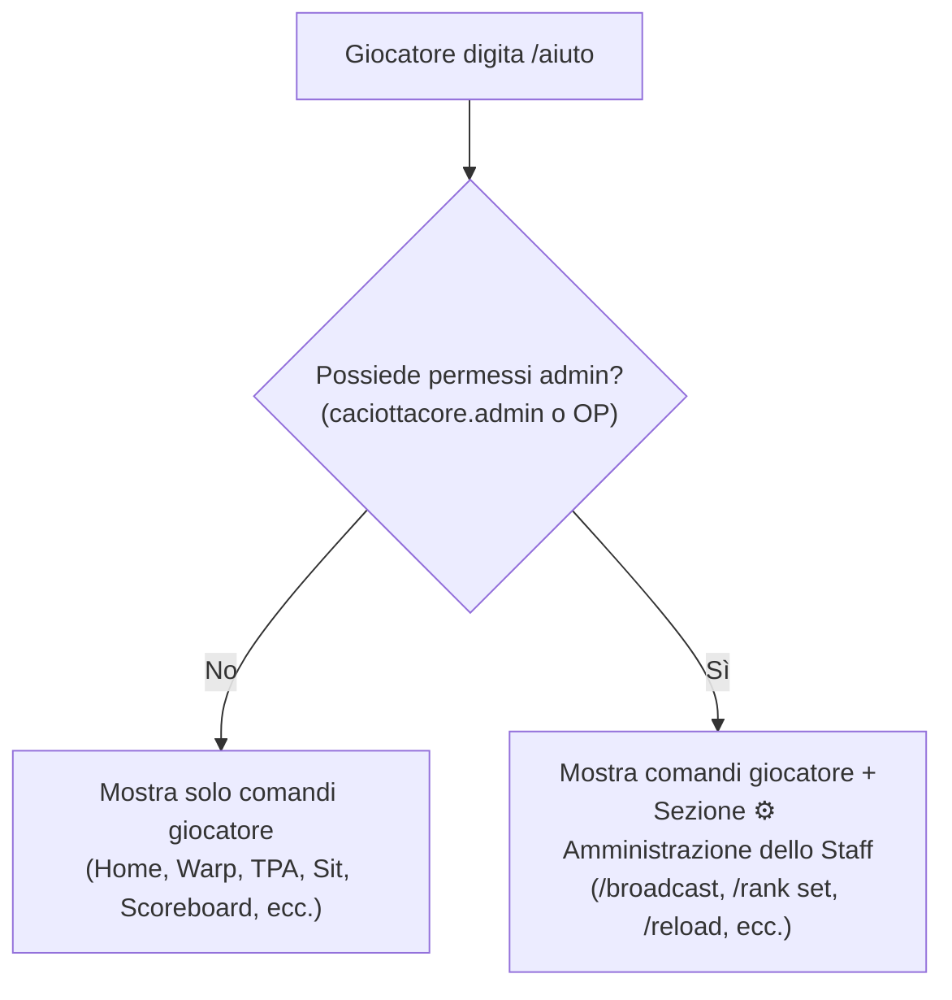

# 🧀 Direttive per lo Sviluppo di Nuovi Comandi - CaciottaCore

Questa guida contiene gli standard architetturali e le procedure obbligatorie per l'implementazione di nuovi comandi e moduli all'interno del plugin **CaciottaCore**.

Tutti i nuovi comandi sviluppati nel progetto devono rispettare i quattro pilastri fondamentali:
1. **Messaggi di default in italiano** (centralizzati e configurabili tramite `ConfigManager` e `config.yml`).
2. **Documentazione interattiva nel comando `/aiuto`** (con filtraggio visivo rigoroso tra comandi utente e admin).
3. **Pieno supporto al ciclo di ricarica a caldo** (integrazione nel comando `/reload` del plugin).
4. **Gestione centralizzata di date, orari e fuso orario** (utilizzo obbligatorio di `TimeManager` e `ConfigManager.getZoneId()` per sincronizzazione con il fuso italiano `Europe/Rome`).

---

## 📑 Indice
- [1. Standard Messaggi in Italiano](#1-standard-messaggi-in-italiano)
  - [1.1 Configurazione in config.yml](#11-configurazione-in-configyml)
  - [1.2 Mappa di Fallback in ConfigManager](#12-mappa-di-fallback-in-configmanager)
  - [1.3 Metodi di invio e formattazione](#13-metodi-di-invio-e-formattazione)
- [2. Documentazione nella Sezione /aiuto](#2-documentazione-nella-sezione-aiuto)
  - [2.1 Comandi Utente vs Comandi Admin](#21-comandi-utente-vs-comandi-admin)
  - [2.2 Come registrare un comando in HelpCommand](#22-come-registrare-un-comando-in-helpcommand)
  - [2.3 Comandi con Argomenti (Suggest) vs Comandi Immediati (Run)](#23-comandi-con-argomenti-suggest-vs-comandi-immediati-run)
- [3. Integrazione con il Sistema di Reload](#3-integrazione-con-il-sistema-di-reload)
  - [3.1 Implementazione del metodo reload() nel Manager](#31-implementazione-del-metodo-reload-nel-manager)
  - [3.2 Hook nel metodo reloadPlugin() di CaciottaCore](#32-hook-nel-metodo-reloadplugin-di-caciottacore)
  - [3.3 Notifica di feedback in ReloadCommand](#33-notifica-di-feedback-in-reloadcommand)
- [4. Gestione Centralizzata di Date, Orari e Fuso Orario](#4-gestione-centralizzata-di-date-orari-e-fuso-orario)
  - [4.1 Utilizzo di TimeManager](#41-utilizzo-di-timemanager)
  - [4.2 Reset Giornalieri e Formattazione con ConfigManager](#42-reset-giornalieri-e-formattazione-con-configmanager)
- [5. Workflow Completo: Checklist per un Nuovo Comando](#5-workflow-completo-checklist-per-un-nuovo-comando)

---

## 1. Standard Messaggi in Italiano

Tutti i messaggi rivolti ai giocatori e alla console (errori di sintassi, permessi negati, avvisi di successo, timer, ecc.) **devono essere scritti in italiano corretto** con codici colore Minecraft standard (`&a`, `&c`, `&e`, `&7`, ecc.).

> [!IMPORTANT]
> **Nessun messaggio deve essere hardcoded** all'interno della classe del comando. Ogni stringa mostrata all'utente deve passare attraverso [ConfigManager](file:///c:/Users/gian/Documents/CaciottaCore/src/main/java/it/caciotta/core/config/ConfigManager.java).

### 1.1 Configurazione in `config.yml`
Aggiungi le chiavi di testo sotto la sezione `messages.<modulo>` in [src/main/resources/config.yml](file:///c:/Users/gian/Documents/CaciottaCore/src/main/resources/config.yml):

```yaml
messages:
  # Esempio per nuovo modulo "teleport"
  teleport:
    usage: "&cUso corretto: &e/{label} <destinazione>"
    not-found: "&cLa destinazione &e{target} &cnon e stata trovata."
    success: "&aTeletrasportato con successo a &e{target}&a!"
    cooldown: "&7Attendi &e{seconds} secondi &7prima di riutilizzare il comando."
```

### 1.2 Mappa di Fallback e Auto-Aggiornamento in `ConfigManager`
Per garantire la massima resilienza:
1. **Fallback in memoria**: definisci sempre i valori di default nella mappa `DEFAULT_MESSAGES` di [ConfigManager.java](file:///c:/Users/gian/Documents/CaciottaCore/src/main/java/it/caciotta/core/config/ConfigManager.java) per evitare stringhe vuote.
2. **Auto-Aggiornamento del `config.yml` su disco**: [ConfigManager.java](file:///c:/Users/gian/Documents/CaciottaCore/src/main/java/it/caciotta/core/config/ConfigManager.java) include il metodo `updateConfigOnDisk()`. Ad ogni avvio o reload, il plugin confronta il file generato sul server con il file di default del JAR ed **aggiunge automaticamente qualsiasi nuova sezione, parametro o messaggio mancante**, preservando sia i valori personalizzati già modificati dall'utente sia i commenti di spiegazione.

```java
// In ConfigManager.java -> DEFAULT_MESSAGES
Map.entry("teleport.usage", "&cUso corretto: &e/{label} <destinazione>"),
Map.entry("teleport.not-found", "&cLa destinazione &e{target} &cnon e stata trovata."),
Map.entry("teleport.success", "&aTeletrasportato con successo a &e{target}&a!"),
Map.entry("teleport.cooldown", "&7Attendi &e{seconds} secondi &7prima di riutilizzare il comando.")
```

### 1.3 Metodi di invio e formattazione
Nel tuo comando, utilizza i metodi helper per recuperare il testo con prefisso e sostituire i placeholder:

```java
// Messaggio semplice con prefisso del plugin
MessageUtil.sendMessage(sender, configManager.getPrefixedMessage("teleport.usage", Map.of("label", label)));

// Messaggio con placeholder dinamici
MessageUtil.sendMessage(player, configManager.getPrefixedMessage("teleport.success", Map.of("target", targetName)));
```

---

## 2. Documentazione nella Sezione `/aiuto`

Tutti i comandi devono essere registrati nel comando interattivo `/aiuto` gestito da [HelpCommand.java](file:///c:/Users/gian/Documents/CaciottaCore/src/main/java/it/caciotta/core/help/HelpCommand.java).



### 2.1 Comandi Utente vs Comandi Admin
- **Comandi Utente**: visibili a chiunque esegua `/aiuto`. Vengono creati tramite il metodo:
  ```java
  createCmd(String usage, String description, String clickCmd, boolean suggestOnly)
  ```
- **Comandi Admin**: visibili **esclusivamente** a chi possiede il permesso `caciottacore.admin` o è operatore `OP`. Vengono creati tramite il metodo:
  ```java
  createAdminCmd(String usage, String description, String clickCmd, boolean suggestOnly)
  ```

### 2.2 Come registrare un comando in `HelpCommand`

All'interno di [HelpCommand.java](file:///c:/Users/gian/Documents/CaciottaCore/src/main/java/it/caciotta/core/help/HelpCommand.java):

#### A. Nella schermata riassuntiva principale (`showAllHelp`):
1. **Se il comando è per tutti gli utenti**:
   ```java
   sender.sendMessage(createCmd("/miocomando", "Descrizione concisa dell'azione", "/miocomando", false));
   ```
2. **Se il comando è per lo staff**:
   Inserirlo rigorosamente all'interno del blocco `if (isAdmin)`:
   ```java
   if (isAdmin) {
       sender.sendMessage(createAdminCmd("/miocomando admin <azione>", "Descrizione azione staff", "/miocomando admin ", true));
   }
   ```

#### B. Nelle sezioni specifiche per categoria (`showSection`):
Ogni modulo deve avere una sezione dedicata o essere accorpato a una esistente (es. `home`, `warp`, `tpa`, `rank`, `admin`):

```java
case "teleport" -> {
    sender.sendMessage(MessageUtil.format("&6🌀 Dettagli Comandi Teletrasporto:"));
    sender.sendMessage(createCmd("/teleport <luogo>", "Teletrasportati in un luogo pubblico", "/teleport ", true));
    
    // Filtro admin all'interno della sottosezione
    if (isAdmin) {
        sender.sendMessage(createAdminCmd("/teleport set <luogo>", "Crea un nuovo punto pubblico", "/teleport set ", true));
    }
}
```

### 2.3 Comandi con Argomenti (`Suggest`) vs Comandi Immediati (`Run`)
Il quarto parametro booleano `suggestOnly` determina cosa succede quando il giocatore clicca sul comando in chat:
- **`true` (Suggest)**: Da usare quando il comando **richiede argomenti obbligatori** (es. `/sethome <nome>`, `/warp <destinazione>`, `/broadcast <msg>`). Il comando viene copiato nella chat del giocatore pronto per completare i parametri.
- **`false` (Run)**: Da usare quando il comando è **auto-conclusivo senza argomenti obbligatori** (es. `/homes`, `/sit`, `/reload`, `/sb`). Cliccandolo viene eseguito immediatamente.

---

## 3. Integrazione con il Sistema di Reload

CaciottaCore supporta la ricarica completa a caldo tramite [`/reload`](file:///c:/Users/gian/Documents/CaciottaCore/src/main/java/it/caciotta/core/command/ReloadCommand.java). Se un nuovo comando fa uso di configurazioni, file YAML o cache in memoria, **deve poter essere ricaricato senza riavviare il server**.

### 3.1 Implementazione del metodo `reload()` nel Manager
Il gestore del nuovo modulo (es. `TeleportManager`) deve esporre un metodo `reload()`:

```java
package it.caciotta.core.teleport;

public class TeleportManager {

    private final CaciottaCore plugin;
    private final File dataFile;
    private final Map<String, Location> cache = new ConcurrentHashMap<>();

    public synchronized void reload() {
        // 1. Svuota le cache in memoria
        cache.clear();

        // 2. Ricarica i file di configurazione da disco
        loadDataFromDisk();

        plugin.getLogger().info("TeleportManager ricaricato con successo.");
    }
    
    // ...
}
```

### 3.2 Hook nel metodo `reloadPlugin()` di `CaciottaCore`
Aggancia la chiamata al metodo `reload()` in [CaciottaCore.java](file:///c:/Users/gian/Documents/CaciottaCore/src/main/java/it/caciotta/core/CaciottaCore.java#L205):

```java
// In CaciottaCore.java -> reloadPlugin()
public void reloadPlugin() {
    if (configManager != null) {
        configManager.reload();
    }
    if (rankManager != null) {
        rankManager.reload();
    }
    // ... altri manager ...

    // Integrazione del nuovo modulo:
    if (teleportManager != null) {
        teleportManager.reload();
    }

    getLogger().info("Tutte le configurazioni e i moduli di CaciottaCore sono stati ricaricati con successo.");
}
```

### 3.3 Notifica di feedback in `ReloadCommand`
Aggiungi una voce descrittiva all'elenco dei moduli ricaricati mostrato all'admin in [ReloadCommand.java](file:///c:/Users/gian/Documents/CaciottaCore/src/main/java/it/caciotta/core/command/ReloadCommand.java):

```java
MessageUtil.sendMessage(sender, " &8» &eteleport &7(Destinazioni e cache posizioni)");
```

---

## 4. Gestione Centralizzata di Date, Orari e Fuso Orario

Qualora un nuovo comando o modulo debba interagire con **data e ora correnti, scadenze, timer, formattazione timestamp o reset giornalieri** (es. contatori giornalieri di `/tpback`), **è obbligatorio fare affidamento al sistema centralizzato** del plugin basato su fuso orario italiano (`Europe/Rome`).

> [!WARNING]
> **Non utilizzare mai** chiamate native prive di fuso orario come `LocalDate.now()` o `LocalTime.now()`, né istanziare `SimpleDateFormat` senza configurare il `TimeZone`. Poiché i server possono risiedere su VPS o host con orario UTC o fusi orari esteri, l'assenza del fuso comporta desincronizzazioni con i giocatori italiani e reset giornalieri ad orari errati.

### 4.1 Utilizzo di `TimeManager`
Il plugin fornisce il gestore [TimeManager.java](file:///c:/Users/gian/Documents/CaciottaCore/src/main/java/it/caciotta/core/time/TimeManager.java), accessibile tramite `plugin.getTimeManager()`, già configurato con il fuso orario del server:

```java
TimeManager timeManager = plugin.getTimeManager();

// Ottenere data e ora correnti nel fuso italiano
ZonedDateTime now = timeManager.now();
LocalDate today = timeManager.today();
LocalTime time = timeManager.currentTime();

// Stringhe formattate pronte per i messaggi o la scoreboard
String dataStr = timeManager.getFormattedDate();       // Es: "13/10/2026"
String oraStr = timeManager.getFormattedTime();         // Es: "20:55:00"
String oraBreve = timeManager.getFormattedShortTime();  // Es: "20:55"
String giorno = timeManager.getDayOfWeek();             // Es: "Martedì"

// Formattare un timestamp epoch (millisecondi) in formato leggibile
String dataFormattata = timeManager.formatTimestamp(System.currentTimeMillis());
```

### 4.2 Reset Giornalieri e Formattazione con `ConfigManager`
Se il modulo gestisce logiche a basso livello (come reset a mezzanotte o persistenza YAML), ricava sempre il `ZoneId` configurato tramite `configManager.getZoneId()`:

```java
// Reset giornaliero (es. TpBackManager):
String oggi = LocalDate.now(configManager.getZoneId()).toString();

// Formattazione thread-safe di scadenze sanzioni (es. ModerationManager):
String scadenza = Instant.ofEpochMilli(punishment.getExpiresAt())
        .atZone(configManager.getZoneId())
        .format(DateTimeFormatter.ofPattern("dd/MM/yyyy HH:mm"));
```

---

## 5. Workflow Completo: Checklist per un Nuovo Comando

Quando aggiungi un nuovo comando a CaciottaCore, segui rigorosamente questa sequenza:

| Fase | File da Modificare | Azione Richiesta |
|---|---|---|
| **1. Logica** | `src/main/java/it/caciotta/core/<modulo>/MioCommand.java` | Crea la classe che implementa `CommandExecutor` e `TabCompleter`. Se gestisci orari o date, usa sempre `TimeManager` o `configManager.getZoneId()`. |
| **2. Testi IT** | [config.yml](file:///c:/Users/gian/Documents/CaciottaCore/src/main/resources/config.yml) | Aggiungi tutte le chiavi dei messaggi in italiano sotto `messages.<modulo>`. |
| **3. Fallback IT** | [ConfigManager.java](file:///c:/Users/gian/Documents/CaciottaCore/src/main/java/it/caciotta/core/config/ConfigManager.java) | Aggiungi i messaggi di fallback nella mappa `DEFAULT_MESSAGES`. |
| **4. Manifest** | [plugin.yml](file:///c:/Users/gian/Documents/CaciottaCore/src/main/resources/plugin.yml) | Registra il comando (`description`, `usage`, `aliases`, `permission`) e dichiara i relativi nodi di permesso con i permessi figli. |
| **5. Registrazione** | [CaciottaCore.java](file:///c:/Users/gian/Documents/CaciottaCore/src/main/java/it/caciotta/core/CaciottaCore.java) | Inizializza il comando in `onEnable()`, collegando executor e tab-completer. |
| **6. Reload** | `MioManager.java` e [CaciottaCore.java](file:///c:/Users/gian/Documents/CaciottaCore/src/main/java/it/caciotta/core/CaciottaCore.java) | Crea `public void reload()` nel Manager e invocalo in `CaciottaCore.reloadPlugin()`. |
| **7. Guida /aiuto** | [HelpCommand.java](file:///c:/Users/gian/Documents/CaciottaCore/src/main/java/it/caciotta/core/help/HelpCommand.java) | Documenta il comando nel menù generale e nella sezione apposita con filtro `if (isAdmin)` per i comandi riservati. |
| **8. Readme** | [README.md](file:///c:/Users/gian/Documents/CaciottaCore/README.md) | Aggiorna la tabella comandi, permessi e descrizioni nella documentazione ufficiale. |
| **9. Compilazione** | Shell Maven | Esegui `.\mvnw.cmd clean package` per verificare che non ci siano errori e aggiornare il JAR in `target/`. |

